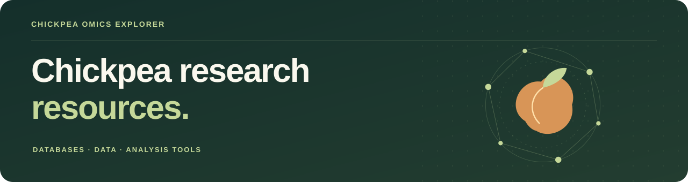

  <a href="http://chickpea.mdu.ac.in"><b>ChickpeaOmicsExplorer ↗</b></a>

  <b>Index</b> &nbsp; <a href="#databases--atlases">Databases &amp; atlases</a>
  &nbsp; / &nbsp; <a href="#data--study-code">Data &amp; study code</a>
  &nbsp; / &nbsp; <a href="#analysis-tools">Analysis tools</a>

## Databases & atlases

<table width="75%">
<tr><td width="690" valign="top">
<h3><a href="https://github.com/LegumeHub/Chickpea-Genomics-Atlas">Chickpea Genomics Atlas ↗</a></h3>

Gene expression across chickpea tissues and developmental stages.

</td></tr>
</table>

<table width="75%">
<tr><td width="690" valign="top">
<h3><a href="http://chickpea.mdu.ac.in">ChickpeaOmicsExplorer ↗</a></h3>

Gene expression, functional annotations and co-expression networks.

<a href="https://github.com/SSGILL14/ChickpeaOmicsExplorer">Supplementary methods ↗</a>

</td></tr>
</table>

## Data & study code

<table width="75%">
<tr><td width="690" valign="top">
<h3><a href="https://github.com/legumeinfo/datastore-metadata/tree/main/Cicer">LIS Cicer metadata ↗</a></h3>

Metadata and provenance for Cicer genome and annotation collections.

</td></tr>
</table>

## Analysis tools

<table width="75%">
<tr><td width="690" valign="top">
<h3><a href="https://github.com/legumeinfo/gcv">Genome Context Viewer ↗</a></h3>

Comparative gene-order and synteny visualization.

</td></tr>
</table>

<table width="75%">
<tr><td width="690" valign="top">
<h3><a href="https://github.com/legumeinfo/pandagma">Pandagma ↗</a></h3>

Pangene and gene-family construction from genome annotations.

</td></tr>
</table>

---

[Suggest a resource](https://github.com/SSGILL14/ChickpeaOmicsResource/issues/new?template=suggest-resource.md) · [Contribution guide](CONTRIBUTING.md)
